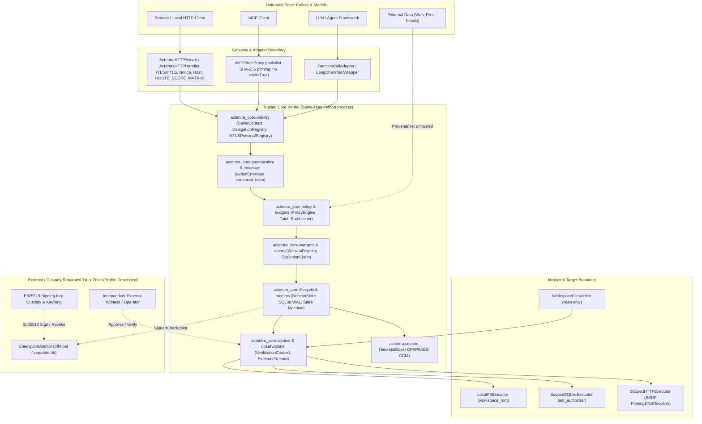
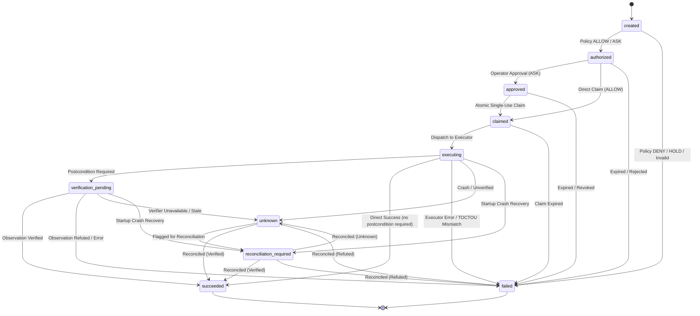
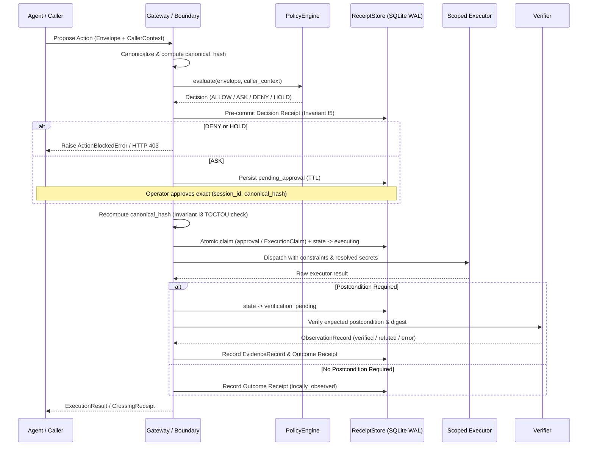
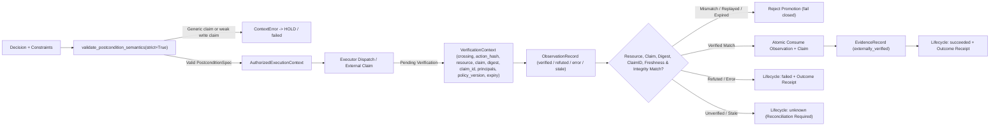
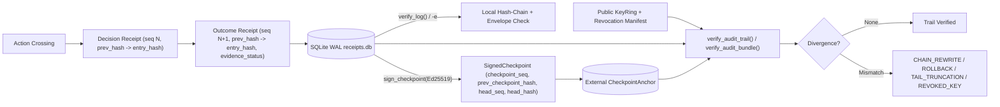

# Actentra Formal Security Model and Trust Boundaries

**Repository:** `https://github.com/SiddardhaShayini/Actentra`  
**Primary Evidence:** Actentra implementation (`core/`, `gateway/`, `executors/`, `sdk/`, `cli/`), test suite (`tests/`), and [ACTENTRA_POST_REMEDIATION_AUDIT.md](file:///d:/Actentra/docs/security/audits/ACTENTRA_POST_REMEDIATION_AUDIT.md) (audited at `85b663a`; current `HEAD` at `ed230bc` with example/notebook/CI/path-resolution updates after `85b663a`).  
**Scope Note:** This document is a formal security contract describing what Actentra currently enforces, what it assumes, what its tests establish (and do not establish), and where its trust boundaries end. It does not claim unverified guarantees or convert deployment prerequisites into automatic defaults.

---

## 1. Purpose and Security Objectives

Actentra is a local-first, deterministic execution boundary for AI-agent tool calls. It sits between untrusted agent/model proposals (originating from LLMs, agent frameworks, MCP clients, or HTTP callers) and privileged target resources (local filesystems, SQLite databases, HTTP endpoints, and scoped credentials).

Its security objectives are:

1. **Mediation without LLM involvement:** Every mediated tool call is canonicalized, risk-tagged, evaluated against a deterministic deny-overrides policy (`PolicyEngine`), and logged before execution (`Boundary.execute()`, `AppServices._dispatch_and_record()`, `MCPStdioProxy`).
2. **Fail-closed defaults:** Ambiguous inputs, canonicalization errors, missing policy rules, expired approvals/warrants/claims, corrupted SQLite databases, and unverified required postconditions fail closed (`DENY`, `HOLD`, `unknown`, `ActionBlockedError`, `DatabaseUnavailableError`, or `CheckpointError`).
3. **Explicit principal, delegation, and session binding:** Transport/application authentication is separated from authorization, delegation requires active registered or signed grants with scope attenuation, and sessions are server-controlled and principal-bound.
4. **Verified execution integrity:** Executor return values are not treated as proof of real-world success when postconditions are required; success promotion is gated on bound postcondition/observation verification and single-use execution claims.
5. **Tamper-evident and optionally anchored auditing:** Decision receipts are committed before execution and paired with outcome receipts in a SHA-256 hash-chained SQLite WAL store (`ReceiptStore`), with optional Ed25519-signed external checkpoints (`CheckpointAnchor`, `KeyRing`) for detecting local database rewrites, rollbacks, and truncation.
6. **Honest guarantees:** Explicitly separate application-level mediation from OS-level sandboxing, local evidence from independent external attestation, and controlled pilot suitability from unconditional external production readiness.

---

## 2. Threat Model

Actentra addresses threats across two main axes: (a) untrusted AI agents/callers interacting with mediated tools, and (b) post-compromise or operational integrity threats against local state and audit logs.

| Threat Category | Specific Threat Vectors | Primary Controls | Residual Risk / Boundary |
|---|---|---|---|
| **Agent / Model Proposals** | Prompt injection, indirect taint via untrusted inputs, hallucinated or malformed parameters, runaway loops | `ActionEnvelope` canonicalization, session & durable principal taint (`principal_taints`), risk tagging, rate limits, dual-tier budgets, `ASK` approval | Semantically harmful actions within allowed policy bounds; unmediated OS/API paths outside Actentra |
| **Identity & Access** | Structured bearer spoofing, principal impersonation, delegation hijacking, cross-principal session access, HTTP route gaps | `resolve_http_caller_context`, `MTLSPrincipalRegistry`, `DelegationRegistry`, server-issued `sess-<uuid>`, `ROUTE_SCOPE_MATRIX` | Shared `auth_token` mode is weaker than mTLS/`token_principals`; compromised operator credentials (`*` scope) |
| **Capability & Replay** | Warrant quota reset via cache eviction, duplicate execution, claim replay, cross-principal claim use, nonce replay | Durable `warrant_usages`, non-evictable finite-use memory fallback, `IdempotencyRecord`, single-use `ExecutionClaim`, `X-Actentra-Nonce` | Ephemeral in-memory `WarrantRegistry` does not survive restarts unless `ReceiptStore` is attached (`require_durable=True` or SQLite backing) |
| **Execution & Postconditions** | Lying/buggy executors, `execute=True` bypass, postcondition weakening (`exists` on write), unrelated observation promotion | `AuthorizedExecutionContext`, `validate_postcondition_semantics(strict=True)`, `VerificationContext`, bound `ObservationRecord` consumption | Local verifier (`WorkspaceFileVerifier`) still trusts the local host filesystem; remote effects require an external witness |
| **Resource Confinement** | Filesystem path traversal, ADS, 8.3 names, symlink/junction TOCTOU; SQLite `ATTACH`/`PRAGMA`/DDL/blocked tables; SSRF & redirects | `canonicalize_windows_path`, Windows ancestor handle locks / POSIX `dir_fd`, `sqlite3.set_authorizer`, `PinningDNSResolver`, `SSRFSafeRedirectHandler` | Not an OS sandbox; in-process code can bypass Actentra; POSIX symlink races not tested on Linux/macOS in latest audit |
| **Gateway & Transport** | Plaintext remote HTTP, DNS rebinding, request smuggling, oversized bodies, forwarded cert/IP header spoofing | Mandatory TLS 1.2+ on non-loopback/`REMOTE`/`PRIVATE_NETWORK`, Host check, 2 MiB cap, `trusted_proxies` check, header stripping | Underlying TLS stack / CA private key compromise; OS-level local network sniffing if loopback is shared with untrusted local users |
| **Audit & Persistence** | Accidental DB corruption, local DB rewrite, backup rollback, tail truncation, crash mid-execution | SQLite WAL + `validate_database_integrity()`, SHA-256 hash chain, chained Ed25519 `CheckpointAnchor`, `KeyRing` revocation, `recover_system_state()` | Local hash chain alone does not stop a DB editor; host admin compromise defeats local-only anchors |

---

## 3. Protected Assets

1. **Target Host Resources:** Workspace files (`LocalFSExecutor`), SQLite tables (`ScopedSQLiteExecutor`), and reachable HTTP endpoints (`ScopedHTTPExecutor`).
2. **Credentials & Secrets:** Opaque `secret:<NAME>` references resolved at dispatch time via `SecretsBroker` (Windows DPAPI `CryptProtectData`/`CryptUnprotectData` or POSIX AES-256-GCM fallback) and scrubbed from envelopes, receipts, and errors.
3. **Authorization & Policy State:** Active `PolicyPack` (pinned by `policy_version`), `DelegationGrant` records, `Warrant` signing keys and `warrant_usages`, `pending_approvals`, `session_budgets`/`principal_budgets`, and `principal_taints`.
4. **Execution Integrity & Lifecycle State:** `action_envelopes`, `action_lifecycle`, `action_transitions`, `idempotency_records`, `execution_claims`, `observations`, `evidence_records`, and `resource_leases`.
5. **Audit Trail & Trust Anchors:** `receipts` hash chain in SQLite WAL, external `SignedCheckpoint` files (`CheckpointAnchor`), and `KeyRing` public key / revocation manifests.

---

## 4. Trust Boundaries and Trusted Components

### Trust Boundaries Diagram

### Trusted Components
- **Kernel (`core/actentra_core/`):** Canonicalization, envelope hashing, deterministic policy evaluation, identity/delegation validation, warrant verification, lifecycle state machine, and SQLite WAL `ReceiptStore`.
- **Gateway & Adapters (`gateway/actentra_gateway/`, `sdk/python/actentra/`):** `Boundary`, `AppServices`, `ActentraHTTPServer`/`ActentraHTTPHandler`, `MCPStdioProxy`, `SecretsBroker`.
- **First-Party Scoped Executors & Verifier (`executors/actentra_executors/`):** `LocalFSExecutor`, `ScopedSQLiteExecutor`, `ScopedHTTPExecutor`, `WorkspaceFileVerifier`.
- **Host OS & Python Runtime:** Actentra runs in-process without OS-level containerization or memory isolation. The host OS kernel, filesystem driver, Python interpreter, and installed packages are part of the Trusted Computing Base (TCB).

---

## 5. Untrusted Components and Attacker Capabilities

- **Untrusted Components:** LLM outputs, tool arguments, `claimed_identity` / `X-Actentra-Identity` headers (when unauthenticated or in remote mode), forwarded cert headers (`X-SSL-Client-Cert`, `X-Forwarded-Client-Cert`, etc., without mTLS socket backing), downstream MCP server tool definitions (subject to rug-pull mutation), external HTTP responses, and unverified external outcome claims.
- **In-Scope Attacker Capabilities:**
  - Prompt injection causing malicious tool arguments, path traversal, SSRF, or SQL injection.
  - Replay of HTTP requests, nonces, idempotency keys, warrants, execution claims, or observations.
  - Caller-supplied identity, session ID, or delegation header spoofing.
  - Lying or buggy executors returning success without achieving the required postcondition.
  - Local SQLite database edits/rollbacks/truncation (detected *only* when external `CheckpointAnchor` + `KeyRing` are configured and custody-separated).
- **Out-of-Scope Attacker Capabilities:**
  - Arbitrary Python code execution inside the Actentra host process (bypasses Python APIs).
  - Compromised host Administrator/root controlling both the Actentra process and all local/external anchors and signing keys.

---

## 6. Principal Authentication and Identity

**Authentication vs. Authorization (Explicit Distinction):**
- **Authentication** establishes *who* the caller is (`authenticated=True`, `authenticated_principal_id`, `PrincipalType`) via `resolve_http_caller_context()` (`core/actentra_core/identity.py`) or `CallerContext`.
- **Authorization** determines *what* that authenticated principal may do: HTTP route scopes (`ROUTE_SCOPE_MATRIX`), object-level ownership checks, `PolicyEngine` rules, `is_agent_allowed()`, and `Warrant` holder matching. An authenticated caller is still denied if they lack the required scope, object ownership, or policy allowance.

**Mechanisms (`core/actentra_core/identity.py`, `gateway/actentra_gateway/http_service.py`):**
- `PrincipalType` distinguishes `LOCAL_PROCESS`, `AUTHENTICATED_OPERATOR`, `AUTHENTICATED_AGENT`, `UNAUTHENTICATED_CALLER`, `DELEGATED_AGENT`, `HUMAN_APPROVER`, and `EXECUTOR`.
- **Bearer Token Verification:** Constant-time comparison (`hmac.compare_digest`) against configured `auth_token` or `token_principals` (supporting per-token revocation and `expires_at`). Configured-secret mode (`enforce_strict_shared_token=True` or `has_server_auth`) rejects arbitrary structured tokens such as `Bearer operator:attacker` with `IdentitySecurityError`.
- **mTLS & Application Principal Binding:** `extract_certificate_identity()` parses DER peer certificates from the TLS socket (`conn.getpeercert(binary_form=True)`). `MTLSPrincipalRegistry` binds SHA-256 fingerprint, SAN URIs, and allowed issuers to `CertificatePrincipalBinding`. `resolve_http_caller_context()` rejects certificate/Bearer-token principal mismatches (`HTTP 403 mtls_identity_mismatch`) and attenuates `scopes` and `allowed_agents` to the intersection of the certificate binding and token principal. Forwarded cert headers are ignored/rejected without an authenticated TLS socket.
- **Reserved Identifiers:** Unauthenticated callers claiming reserved IDs (`system`, `kernel`, `admin`, `root`, `actentra_internal`, `policy_kernel`) fail closed with `IdentitySecurityError`.

| Property | Module | Tests | Assumptions & Limitations | Audit Reproduction |
|---|---|---|---|---|
| Bearer & structured-token fail-close | `core/actentra_core/identity.py`, `http_service.py` | `test_security_finding_01_identity.py`, `test_phase1_identity_hardening.py` | Shared `auth_token` mode is weaker than `token_principals` + mTLS; remote mode blocks `X-Actentra-Identity` impersonation | **Reproduced** (`operator:attacker` raised `IdentitySecurityError`) |
| mTLS + token principal binding | `core/actentra_core/identity.py`, `http_service.py` | `test_phase4_mtls_principal_binding.py` | Requires `require_client_cert=True` and `MTLSPrincipalRegistry`; tests use real loopback TLS sockets with test CAs | **Reproduced** (Alice cert + Bob token -> 403; Alice + Alice -> 200) |

---

## 7. Delegation and Authority Attenuation

- **Mechanism (`core/actentra_core/identity.py`):** `DelegationGrant` and `DelegationRegistry` enforce bidirectional binding: `grant.delegatee_id == authenticated_caller.principal_id` and `grant.delegator_id == caller.delegated_by`.
- **Attenuation & Limits:** Child grants cannot exceed parent `scopes` or `allowed_agents`, increment `depth = parent.depth + 1` bounded by `max_depth`, and have `expires_at` bounded by the parent grant. Revoking a parent grant cascades transitively to descendants.
- **Signed Grants:** `issue_signed_delegation_grant()` and `verify_signed_delegation_grant()` use Ed25519 signatures with `nonce`, `issued_at` (clock-skew check), `expires_at`, and optional `audience` binding.
- **What Tests Establish / Do Not Establish:** `test_phase1_identity_hardening.py` establishes grant substitution rejection, cascading revocation, depth/expiration bounds, and signature checks in unit/service tests. It does not establish external OIDC/SAML federation (an explicit non-goal).
- **Audit Status:** Verified remediated in `ACTENTRA_POST_REMEDIATION_AUDIT.md`.

---

## 8. Policy Evaluation and Authorization

- **Mechanism (`core/actentra_core/policy.py`):** `PolicyEngine.evaluate()` performs deterministic, zero-LLM evaluation over `ActionEnvelope`:
  1. Checks global emergency freeze (`_frozen`) -> `HOLD`.
  2. Computes deterministic risk tags (`core/actentra_core/risk.py`, e.g., `untrusted-provenance`, `external-egress`, `destructive`, `privilege-escalation-risk-deny`).
  3. Tracks provenance and session/principal taint (`principal_taints` in SQLite; taint inherits across new sessions and can only be cleared by a trusted operator).
  4. Enforces rate limits (`RateLimiter`, process-local) and dual-tier cumulative budgets (`core/actentra_core/budgets.py`, persisted in SQLite `session_budgets` and `principal_budgets`).
  5. Evaluates YAML policy rules with **deny-overrides** semantics (`DENY` > `HOLD` > `ASK` > `ALLOW_WITH_CONSTRAINTS` > `ALLOW`). Missing rules fail closed.
- **Hot Reload (`I6`):** `PolicyStore` validates candidate policies completely before swapping active references.
- **HTTP & Service Authorization:** `ROUTE_SCOPE_MATRIX` (`http_service.py`) maps every GET/POST/DELETE route to required scopes, and `AppServices` replicates scope and object-level ownership checks for reads (redacting parameters with `{"_redacted": "UNAUTHORIZED_RESOURCE_ACCESS"}` for unauthorized observers).
- **What Tests Establish / Do Not Establish:** `test_policy.py`, `test_budgets.py`, `test_dry_run_and_taint.py`, and `test_phase2_session_and_authorization.py` establish rule precedence, fail-closed invalid policy reload, durable budgets across restarts, and route/object authorization. They do not establish semantic correctness of user-authored YAML policies.

---

## 9. Warrant and Quota Enforcement

- **Mechanism (`core/actentra_core/warrants.py`):** `Warrant` tokens are Ed25519-signed capability grants binding `warrant_id`, `issuer`, `holder`, `allowed_tools`, `allowed_resources`, `max_uses`, and `expires_at`.
- **Holder & Scope Binding:** `Boundary` verifies the Ed25519 signature (`verify_warrant()`), checks `holder` matches the authenticated principal (or active delegator), and checks `is_action_permitted_by_warrant()`.
- **Quota Durability & Anti-Eviction:**
  - When attached to `ReceiptStore` (or `db_path`), `WarrantRegistry.record_use()` persists usage counts atomically in SQLite `warrant_usages` (`record_warrant_use`).
  - In standalone in-memory fallback (`receipt_store is None`), active and exhausted finite-use warrants are **non-evictable**; if capacity (`max_warrants`) is saturated, `record_use()` fails closed with `WarrantError`. When `require_durable=True`, finite-use warrants require a `ReceiptStore`.
- **What Tests Establish / Do Not Establish:** `test_warrants.py` and `test_security_finding_03_warrant_quotas.py` establish signature verification, holder binding, SQLite durability across restarts, and in-memory fail-closed saturation. In-memory fallback does not survive process restarts by design.
- **Audit Status:** Standalone finite-use warrant saturation/replay failure was **independently reproduced** in `ACTENTRA_POST_REMEDIATION_AUDIT.md`.

---

## 10. Approval and Execution Lifecycle

**Authorization vs. Execution (Explicit Distinction):**
- **Authorization** (`POST /v1/crossings` without `execute=true`, or `PolicyEngine.evaluate()`) produces a `Decision` (`ALLOW`, `ASK`, `DENY`, `HOLD`) and records a decision receipt. It does **not** mean the action was executed or succeeded.
- **Execution** dispatches the tool (either locally via `_dispatch_and_record()` / `Boundary.execute()`, or externally via `ExecutionClaim` + outcome submission) and transitions the crossing through the lifecycle state machine.

### Agent-to-Actentra Action Lifecycle Diagram

### Authorization and Execution Sequence Diagram

- **Implementation:** `core/actentra_core/lifecycle.py` (`LEGAL_TRANSITIONS`, `validate_lifecycle_transition()`), `sdk/python/actentra/boundary.py`, `gateway/actentra_gateway/services.py` (`_dispatch_and_record()`).
- **Tests:** `test_phase7_production_reliability.py`, `test_phase8_complete_hardening.py`, `test_gateway_postcondition_enforcement.py`.

---

## 11. Claims, Single-Use Enforcement, and Replay Protection

Actentra enforces single-use and anti-replay across four distinct layers:

1. **Approval Grants (`I4`):** Bound to `(session_id, canonical_hash)` with monotonic TTL; atomically transitioned from `approved` to `consumed` in SQLite `BEGIN IMMEDIATE` (`claim_approval_for_execution()`).
2. **Execution Claims (`core/actentra_core/claims.py`):** Required for external outcome reporting (`POST /v1/crossings/{id}/claim` -> `POST /v1/crossings/{id}/outcome`). `ExecutionClaim` binds `claim_id`, `crossing_id`, `executor_principal_id`, `session_id`, `canonical_hash`, `expires_at`, `approval_or_warrant_id`, and `claim_hash`. Consumption is atomic (`consumed_at` set once); replay or cross-principal use fails closed.
3. **Durable Idempotency (`core/actentra_core/lifecycle.py`):** `idempotency_records` keyed by `(principal_id, idempotency_key)` bound to `canonical_hash` and `tool`. Completed replays return cached results without re-dispatch; differing parameters raise `IdempotencyConflictError`; concurrent in-flight calls raise `IdempotencyInFlightError`; crashed actions raise `ReconciliationRequiredError`.
4. **HTTP Transport Nonces (`http_service.py`):** Sliding-window single-use `X-Actentra-Nonce` and `X-Actentra-Timestamp` skew validation (`+/-300s`). Nonce cache (`_seen_nonces`) is process-local.

---

## 12. Executor Trust Assumptions

Actentra's four first-party executors (`executors/actentra_executors/`) are trusted to enforce resource confinement *within* the Actentra process, subject to explicit OS and environment assumptions:

- **`LocalFSExecutor` (`fs.py`):** Confined to `workspace_root`; rejects `..`, ADS, 8.3 short names, device names, and reparse points. Assumes no concurrent kernel/admin bypass breaking Win32 handle locks.
- **`ScopedHTTPExecutor` (`http.py`):** Enforces HTTP/HTTPS only, `PinningDNSResolver`, and `SSRFSafeRedirectHandler` blocking loopback, RFC1918, link-local, and `169.254.169.254` on initial connect and every redirect hop. Assumes OS resolver is not compromised below the Python socket/DNS layer; public-network SSRF was not tested in the latest audit.
- **`ScopedSQLiteExecutor` (`sqlite.py`):** Enforces single-statement SQL, rejects comments (`--`, `/*`), and installs `sqlite3.set_authorizer` blocking `ATTACH`, `DETACH`, `PRAGMA`, DDL, and unauthorized tables across JOINs, CTEs, subqueries, views, and triggers.
- **`WorkspaceFileVerifier` (`verifiers.py`):** Read-only local filesystem verifier capped at 50 MiB (`_MAX_DIGEST_READ_BYTES`) for digest computation.
- **No Arbitrary Shell Executor:** Actentra intentionally omits a `shell.exec` executor; starter policy denies `shell.exec`, and `MCPStdioProxy` spawns servers via `Popen(server_cmd)` without `shell=True`.

---

## 13. Postcondition Verification

**Executor-Reported Success vs. Verified Success (Explicit Distinction):**
- An executor returning without error only means the local callable or external caller *reported* completion. It is **not** proof that the target state matches the authorized intent.
- Under `Boundary.execute()` and `AppServices._dispatch_and_record()` (`gateway/actentra_gateway/services.py`), when policy constraints require postconditions (`require_postcondition`, `postcondition`, `required_postconditions`, or `strict_postconditions`):
  1. `validate_postcondition_semantics(strict=True)` (`core/actentra_core/context.py`) rejects generic claims (`verified`, `ok`, `success`, `true`, `any`, `all`, `none`, `pass`, `valid`, `""`) and rejects weak claims (e.g., `exists` on `write` operations requires `digest_match`; `delete` requires `absent`).
  2. `AuthorizedExecutionContext` binds action identity, resource, principal, executor, approval, policy version, and postcondition spec.
  3. Success is promoted **only** after the verifier returns `status="verified"` matching the expected claim/digest. `refuted` or `error` transitions to `failed`; missing/unavailable verifier or `stale`/`unknown` observation preserves `unknown` (never promoted to `succeeded`).

### Postcondition and Evidence Verification Diagram

- **Audit Reproduction:** `ACTENTRA_POST_REMEDIATION_AUDIT.md` Section 4.3 independently reproduced `execute=True` with lying/wrong-content executors and confirmed they produced failure/unknown outcomes rather than success.

---

## 14. Observation and Evidence Binding

**Local Evidence vs. Independent External Attestation (Explicit Distinction):**
- **`locally_observed`** (`EvidenceTier.LOCALLY_OBSERVED`): Produced by first-party scoped executors inside the Actentra host process. Proves what the local executor observed, not independent remote state.
- **`caller_reported`** (`EvidenceTier.CALLER_REPORTED`): Produced when an external caller reports an outcome without bound verification. Proves *what the caller reported*, not real-world state.
- **`externally_verified`** (`EvidenceTier.EXTERNALLY_VERIFIED`): Produced when an `ObservationRecord` is corroborated against a `VerificationContext` (`core/actentra_core/observations.py`). Even `WorkspaceFileVerifier` runs in `trust_domain="local_host"` (local filesystem truth, not a remote cryptographic witness). True remote attestation requires an independent `external_witness` verifier outside the execution host.

**Binding Rules (`gateway/actentra_gateway/services.py`):**
- `VerificationContext` hashes `verification_id`, `crossing_id`, `canonical_action_hash`, `authorized_resource`, `expected_postcondition`, `expected_digest`, `claim_id`, `executor_principal_id`, `verifier_principal_id`, `policy_version`, `observed_at`, and `expires_at`.
- `_validate_bound_observation_for_outcome()` rejects integrity failures, already-consumed observations (`consumed_at is not None`), crossing/claim/action-hash/executor/resource/claim-type/digest mismatches, and expired observations.
- **Audit Reproduction:** `ACTENTRA_POST_REMEDIATION_AUDIT.md` Section 4.4 confirmed unrelated-resource observation promotion is rejected.

---

## 15. Receipt Integrity and Audit Checkpoints

**Hash-Chain Integrity vs. Independently Anchored Tamper Resistance (Explicit Distinction):**
- **Hash-chain integrity** (`verify_log()` in `core/actentra_core/receipts.py`) verifies that each row's `prev_hash` equals the prior `entry_hash` and matches the SHA-256 of canonical fields (including `evidence_status`). It detects accidental corruption and uncoordinated edits, **but cannot stop an attacker with SQLite write access from rewriting history and recomputing the hash chain**.
- **Independently anchored tamper resistance** (`core/actentra_core/checkpoints.py`) requires periodic Ed25519-signed `SignedCheckpoint` records (`checkpoint_seq`, `prev_checkpoint_hash`, `head_seq`, `head_hash`) written to a custody-separated `CheckpointAnchor` and verified against a `KeyRing` (`verify_audit_trail()`, `verify_audit_bundle()`). Only then can offline verification detect `CHAIN_REWRITE`, `ROLLBACK`, `TAIL_TRUNCATION`, `CHECKPOINT_TAMPERING`, `SIGNATURE_FORGERY`, `UNTRUSTED_KEY`, and `REVOKED_KEY`.

### Receipt and Audit Integrity Flow Diagram

- **Tests:** `test_receipts.py`, `test_checkpoints.py`, `test_phase5_production_trust_anchoring.py`, `test_phase6_audit_architecture.py`.
- **Limitation:** Actentra does not ship a built-in remote witness service or hardware HSM integration; `FileCheckpointAnchor` on the same host does not protect against a compromised host administrator (`protects_against_compromised_host: False`).

---

## 16. Filesystem Confinement

**Application-Level Enforcement vs. OS-Level Isolation (Explicit Distinction):**
- `LocalFSExecutor` (`executors/actentra_executors/fs.py`) enforces path confinement at the **application layer** using OS handle/descriptor primitives. It does **not** place the Python process inside an OS sandbox (e.g., AppContainer, chroot, seccomp, or Linux namespaces). Any unmediated code in the same process can still call `open()` directly.

**Platform Mechanisms (`fs.py`):**
- **Path Canonicalization:** Rejects `..`, Windows Alternate Data Streams (`:`), 8.3 short names (`~`), reserved device names (`CON`, `PRN`, `AUX`, `NUL`, `COM1-9`, `LPT1-9`), and UNC/device namespaces.
- **Windows:** Segment-by-segment directory handle traversal via `CreateFileW` (`FILE_FLAG_BACKUP_SEMANTICS | FILE_FLAG_OPEN_REPARSE_POINT`, omitting `FILE_SHARE_DELETE`) holding open ancestor handles from `workspace_root` to the parent directory, rejecting `FILE_ATTRIBUTE_REPARSE_POINT` via `GetFileInformationByHandle`, verifying `GetFinalPathNameByHandleW`, writing to an `O_CREAT | O_EXCL` temp file, re-verifying the parent handle ID before `os.replace()`, and deleting via `SetFileInformationByHandle(FileDispositionInfo)`.
- **POSIX:** Segment-by-segment `openat`-style traversal (`O_RDONLY | O_DIRECTORY | O_NOFOLLOW`), descriptor-relative `os.open(..., dir_fd=...)`, `os.mkdir(..., dir_fd=...)`, `os.replace(..., src_dir_fd=..., dst_dir_fd=...)`, and `os.unlink(..., dir_fd=...)`.
- **Tests & Audit Gap:** `test_fs_executor.py` and `test_phase3_fs_race_confinement.py` pass on Windows for real concurrent write/replace races, **except** `tests/unit/test_fs_executor.py:207` (symlink creation) is skipped when the Windows environment lacks symlink privilege, and Linux/macOS POSIX `dir_fd` race tests were not executed in the Windows-only audit.

---

## 17. Network and Gateway Security

Implemented in `gateway/actentra_gateway/http_service.py`:

- **Deployment Modes (`DeploymentMode`):** `LOCAL` (default loopback `127.0.0.1`/`::1`), `PRIVATE_NETWORK`, and `REMOTE`.
- **Mandatory TLS on Remote Bindings:** Non-loopback hosts or `REMOTE`/`PRIVATE_NETWORK` modes fail closed at `ActentraHTTPServer.__init__` unless TLS (`ssl_context` or `certfile`+`keyfile`) and authentication (`auth_token` or `token_principals`) are configured. `create_tls_context()` enforces TLS 1.2+ (`MINIMUM_VERSION`), disables compression (`OP_NO_COMPRESSION`), and configures forward-secret AEAD ciphers (`ECDHE+AESGCM`, `ECDHE+CHACHA20`).
- **DNS Rebinding & Request Smuggling:** Validates `Host` against `allowed_hosts` or loopback, rejects conflicting `Content-Length` / `Transfer-Encoding` headers, enforces a 2 MiB body limit (`HTTP 413`), and ignores `X-Forwarded-For` unless the peer IP is in `trusted_proxies`.
- **CORS:** Disallows wildcard `*`; restricts to matching loopback origins or `X-Actentra-Client`.
- **Tests:** `test_http_service.py`, `test_phase3_remote_gateway_security.py`, `test_phase4_mtls_principal_binding.py`, `test_http_executor.py`, `test_security_finding_02_dns_rebinding.py`.

---

## 18. Persistence, Crash Recovery, and Reconciliation

Implemented in `core/actentra_core/receipts.py` and `core/actentra_core/lifecycle.py`:

- **SQLite WAL Configuration:** `journal_mode=WAL`, `foreign_keys=ON`, `busy_timeout=15000` (ms), and `BEGIN IMMEDIATE` transactions for state mutations.
- **Integrity & Fail-Closed Storage:** `ReceiptStore.validate_database_integrity()` checks `PRAGMA quick_check`, receipt sequence continuity (`1..N`), and hash-chain linkage. Missing or corrupted databases raise `DatabaseUnavailableError` rather than falling back to in-memory state.
- **Startup Recovery (`recover_system_state()`):** Invoked automatically by `Boundary.__init__` and `AppServices.__init__`. Expires stale `pending_approvals`, `resource_leases`, and dangling `execution_claims`; transitions crashed `executing` / `verification_pending` lifecycles and `in_flight` idempotency records to `reconciliation_required`; marks interrupted `ALLOW` decisions lacking outcomes as `unknown`; removes stale `.tmp_*` checkpoint files.
- **Reconciliation:** `Boundary.reconcile_outcome()` / `AppServices.reconcile_outcome()` transitions `unknown` or `reconciliation_required` crossings to `succeeded` or `failed` only upon verified observation evidence, recording an immutable `outcome_reconciliations` entry.
- **Residual Crash Window:** A side effect may occur in the target system just before a crash before the outcome receipt is written; Actentra guarantees this state is flagged `unknown` / `reconciliation_required` rather than silently promoted to `succeeded`.

---

## 19. Deployment Profiles

Implemented in `core/actentra_core/checkpoints.py` (`SecurityProfile`, `validate_production_trust_configuration()`, `assess_audit_guarantees()`) and `gateway/actentra_gateway/http_service.py`:

| Profile | Audit Anchor & KeyRing | Gateway Auth & Transport | Intended Use |
|---|---|---|---|
| `local_dev` / `local_trusted` | Optional (`externally_anchored: False` when absent) | Loopback HTTP allowed; `auth_token` optional on loopback | Local development and unit testing |
| `controlled_pilot` | **Required** (`CheckpointAnchor` + active `KeyRing` key; existing trail must verify) | Remote/private bindings require TLS + auth | Controlled, single-host or trusted-network pilots |
| `external_production` | **Required** + **durable & custody-separated** (`MemoryCheckpointAnchor` and same-DB-dir `FileCheckpointAnchor` rejected) | **Required** `require_client_cert=True`, `cert_principals`, and individual `token_principals`/`cert_principals` (shared `auth_token` alone rejected) | Stricter deployment posture (still subject to Section 21 limits) |

**Controlled Pilot vs. Production Readiness (Explicit Distinction):**
- `SecurityProfile.EXTERNAL_PRODUCTION` enforces stricter configuration gates in code, **but passing those gates does not by itself certify Actentra for unconditional external production**. As concluded in `ACTENTRA_POST_REMEDIATION_AUDIT.md`, Actentra is currently verified for **restricted controlled pilots** only (same-host trusted Python process, disposable or explicitly authorized targets, no unmediated agent paths, and external witness/SIEM integration provided by the operator).

---

## 20. Platform-Specific Guarantees

- **Windows 11 / amd64 (Python 3.12+):** Primary tested platform in `ACTENTRA_POST_REMEDIATION_AUDIT.md`. Real filesystem concurrency tests, loopback TLS/mTLS socket tests, DPAPI `SecretsBroker`, and SQLite WAL recovery tests were executed here. **Gap:** Symlink creation in `test_fs_executor.py:207` was skipped due to missing OS symlink privilege in the test environment.
- **Linux / macOS (POSIX):** POSIX `dir_fd` (`O_NOFOLLOW | O_DIRECTORY`) confinement, `canonicalize_windows_path` POSIX root handling (fixed in `8aec173`), and AES-256-GCM fallback in `SecretsBroker` are implemented in source, **but were NOT executed or certified in the Windows-only `ACTENTRA_POST_REMEDIATION_AUDIT.md`**. Untested platforms must not be treated as certified until a full test and POSIX symlink race campaign runs on each target OS.

---

## 21. Known Limitations and Explicit Non-Goals

1. **Not an OS Sandbox:** Actentra is an in-process Python library/gateway. Arbitrary Python code or unmediated OS/API access bypasses Actentra completely.
2. **Same-Host TCB:** If the host OS administrator or kernel is compromised, local `PolicyEngine`, `SecretsBroker`, and `ReceiptStore` protections can be bypassed (only previously exported off-host checkpoints remain tamper-evident).
3. **No Built-In Arbitrary Shell Executor:** Intentionally omitted (`shell.exec` denied in starter policy).
4. **Local-Only Default Verifier:** `WorkspaceFileVerifier` checks local disk state; remote APIs/services require operator-supplied external witnesses.
5. **Process-Local State:** `RateLimiter._buckets`, `PolicyEngine._frozen`, HTTP `_seen_nonces`, and unattached in-memory `WarrantRegistry` caches reset on process restart.
6. **No Enterprise Multi-Tenancy or OIDC/SAML:** Multi-tenant cloud control planes and OIDC/SAML JWKS federation are out of scope for v1.
7. **Unverified External Attack Surfaces in Latest Audit:** No external penetration test, third-party dependency audit, release-signing validation, or real public-network SSRF/DNS-rebinding test against live external DNS was performed.

---

## 22. Security Testing and Independent Verification

**Observed Verification Baseline (`ACTENTRA_POST_REMEDIATION_AUDIT.md` at `85b663a` and sandboxed verification at `ed230bc`):**
- **Audit Baseline (`85b663a`):** `uv run pytest -o addopts= -q -rs` reported `403 passed, 1 skipped` (`tests/unit/test_fs_executor.py:207` skipped due to Windows symlink privilege).
- **Current `HEAD` (`ed230bc`, sandboxed Windows run):** `uv run pytest -o addopts= -q -rs` reported `414 passed, 10 skipped` (7 loopback socket skips due to sandbox `WinError 10013`, 3 symlink/junction privilege skips in `test_fs_executor.py:187`, `test_fs_executor.py:207`, and `test_phase3_fs_race_confinement.py:301`).
- **Static Analysis (`ed230bc`):** `uv run ruff check core executors gateway sdk cli tests` (All checks passed) and `uv run mypy` (`strict = true`, 41 source files, 0 issues).
- **Targeted Security & Reliability Suites:**
  - Identity & Delegation: `test_security_finding_01_identity.py`, `test_phase1_identity_hardening.py` (establishes bearer fail-close, grant binding, attenuation, cascading revocation; does not establish external IdP security).
  - Session, Budgets, Taint & Route Auth: `test_phase2_session_and_authorization.py`, `test_budgets.py` (establishes SQLite persistence across restarts and concurrent locks; does not establish protection against host DB deletion).
  - Remote Gateway & mTLS: `test_phase3_remote_gateway_security.py`, `test_phase4_mtls_principal_binding.py` (establishes TLS/mTLS handshake & principal binding over loopback sockets with test certs; does not establish CA operational security).
  - Filesystem & Executor Hardening: `test_phase3_fs_race_confinement.py`, `test_phase4_executor_hardening.py`, `test_fs_executor.py`, `test_sqlite_executor.py`, `test_http_executor.py`, `test_security_finding_02_dns_rebinding.py` (establishes Windows race resistance for `os.replace`, SQLite authorizer blocking, and mocked/local SSRF pinning; does not establish POSIX symlink race resistance on Linux/macOS or live public-network DNS behavior).
  - Execution Integrity, Postconditions & Claims: `test_phase2_observation_binding.py`, `test_phase5_execution_integrity.py`, `test_gateway_postcondition_enforcement.py`, `test_security_finding_04_postconditions.py`, `test_security_finding_05_external_outcomes.py` (establishes claim single-use, context binding, and rejection of lying executors; does not establish independent remote ground truth without an external witness).
  - Audit Anchoring, Chaos, Property & Crash Recovery: `test_phase5_production_trust_anchoring.py`, `test_phase6_audit_architecture.py`, `test_phase7_production_reliability.py`, `test_phase8_complete_hardening.py`, `test_chaos.py`, `test_properties.py` (establishes hash-chain/checkpoint divergence detection, Hypothesis invariants, SQLite corruption fail-close, and startup crash recovery; no standalone fuzzing corpus exists beyond Hypothesis property tests).
